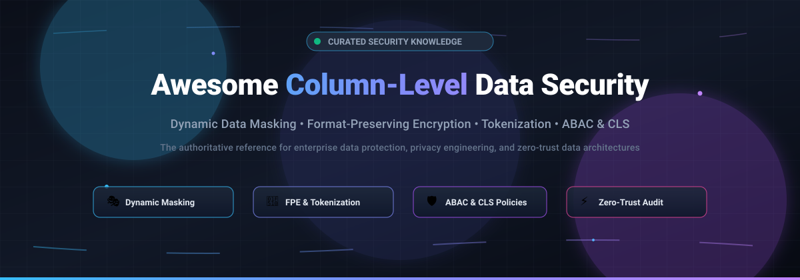

# 🛡️ Awesome Column-Level Data Security 🔐

**A Curated Directory of SaaS Products, Open-Source Solutions, and Frameworks for Column-Level Security (CLS), Dynamic Data Masking (DDM), Format-Preserving Encryption (FPE), Tokenization, and Attribute-Based Access Control (ABAC).**

🌟 *Star this repository to stay updated on modern data security, privacy engineering, and zero-trust data architectures!* 🌟

---

## 📌 Introduction & Overview 📖

Organizations handling sensitive fields—such as **PII (Personally Identifiable Information)**, financial records (PCI-DSS), electronic protected health information (ePHI / HIPAA), and intellectual property—must prevent unauthorized exposure while retaining analytical utility.

**Column-Level Data Security (CLS)** and **Dynamic Data Masking (DDM)** solve this by evaluating runtime user context, privileges, and attributes to selectively mask, tokenize, or encrypt column data at query execution or at rest.

Whether you are evaluating enterprise SaaS governance suites or self-hosting open-source gateways, this repository provides a comprehensive, vendor-neutral comparative reference.

---

## 📑 Table of Contents 🧭

- [🌐 Sector Overview & Market Dynamics](#-sector-overview--market-dynamics)
- [🏢 SaaS / Hosted Platforms](#-saashosted-platforms)
- [💻 Open-Source GitHub Projects](#-open-source-github-projects)
- [🧰 Additional Specialized Open-Source Tools](#-additional-specialized-open-source-tools)
- [🤝 How to Contribute](#-how-to-contribute)
- [💖 Support & Sponsorship](#-support--sponsorship)
- [⚠️ Architecture Trade-Offs & Disclaimer](#-architecture-trade-offs--disclaimer)
- [📊 Star History](#-star-history)

---

## 🌐 Sector Overview & Market Dynamics 📈

The global data security and data access governance (DAG) sector is estimated at **$14.7B – $17.2B in 2025–2026** (scaling past $37B by 2031 at ~17% CAGR), with dedicated data access governance accounting for ~$2.1B+ and rapidly rising.

The market is **moderately fragmented** rather than winner-take-all: high-scale cloud platforms (Snowflake, Databricks, Hyperscalers) capture baseline storage governance, while specialized pure-play platforms compete intensely and drive active M&A activity for cross-platform attribute-based access control (ABAC), tokenization, and dynamic runtime masking.

---

## 🏢 SaaS/Hosted Platforms ☁️

| Platform | Company Size (Valuation / Revenue) | Pricing | Free Tier / Trial Limit | Key Capabilities & Best For |
| :--- | :--- | :--- | :--- | :--- |
| **[Snowflake Column-Level Security](https://www.snowflake.com/)** | **~$110B–$115B** Market Cap / ~$5.9B Revenue | Dynamic Data Masking requires Enterprise Edition starting at **$3.00/credit** (Standard is $2.00/credit, Business Critical is $4.00/credit; on-demand) | **30-day free trial** with **$400 in usage credits** (trial ends after 30 days or when $400 is depleted; no forever-free tier) | Native masking policies and external tokenization within Snowflake; best for Snowflake-centric workloads without 3rd-party tools. |
| **[Commvault / Satori](https://www.satori.ai/)** | **~$7.0B–$7.4B** Market Cap / ~$1.22B Revenue *(Commvault acquired Satori; standalone was $95k/yr avg)* | Enterprise contract starting around **$95,000/year** (Satori standalone average deal via Commvault data security offerings) | **Vendor-guided trial / interactive sandbox** (no self-serve forever-free tier) | Universal Data Access Service providing dynamic masking, access workflows, and discovery across multi-cloud stores. |
| **[Varonis](https://www.varonis.com/)** | **~$5.6B** Market Cap / ~$688M Revenue | Starting around **$55 – $95/user/year** (base Microsoft 365 coverage) to **$80 – $140/user/year** (multi-platform DSPM/coverage); typical enterprise minimums ~$15k–$50k/yr | **30-day free trial** (enterprise evaluation/guided data risk assessment; no forever-free tier) | Data security platform with column-level discovery, classification, and permissions right-sizing. |
| **[Immuta](https://www.immuta.com/)** | **~$1.0B** Valuation (Series E Unicorn) / ~$23M+ ARR | Annual contract pricing starting at **$96,000/year** (baseline AWS Marketplace 12-month tier covering 960 Immuta Units) | **14-day free trial** (available via AWS Marketplace / guided sandbox; no forever-free tier) | Dynamic attribute-based access control (ABAC) natively translated into Snowflake, Databricks, Redshift, and Starburst. |
| **[Privacera](https://www.privacera.com/)** | **~$250M–$500M** Est. Valuation / ~$38.5M Revenue | Foundation package starting at **$100,000/year** (12-month Data Access Governance Starter Pack on AWS Marketplace) | **30-day free trial** on cloud environments (PrivaceraCloud evaluation; no forever-free tier) | Policy-driven encryption and masking via PEG (Privacera Encryption Gateway); format-preserving encryption (FPE) and tokenization. |
| **[ALTR](https://www.altr.com/)** | **~$100M–$250M** Est. Valuation / ~$8M–$10M Revenue | Paid tier starts at **$10/data user/month** (Enterprise plan; custom quotes for enterprise scale) | **Free Forever Tier**: **$0/month** (up to 3 connected databases, full data classification, and dynamic masking via Snowflake Partner Connect) | Tag-based dynamic column masking and data governance with native Snowflake & cloud warehouse integration. |
| **[Baffle](https://baffle.io/)** | **~$100M–$250M** Est. Valuation / ~$3.3M ARR | Instance-based metered pricing from **~$0.40 – $1.50/hour** (depending on EC2 instance size e.g. t3.large to m5.xlarge; enterprise contracts via private offer) | **30-day free trial** (available on AWS Marketplace for RDS, Aurora, and S3; excludes underlying AWS infra costs) | No-code cryptographic protection; field- and column-level format-preserving encryption without application code changes. |
| **[Protegrity](https://www.protegrity.com/)** | **~$50.7M** Est. Revenue (~$25M–$100M industry range) | Enterprise contract-based units; minimum annual deployments typically start at **~$50,000 – $100,000/year** via AWS private offers | **30-day free trial** on select modules (e.g., Cloud Protect for S3; enterprise PoC on request; no forever-free tier) | Enterprise-grade tokenization and format-preserving encryption using warehouse User-Defined Functions (UDFs). |
| **[Cyral](https://cyral.com/)** | *Acquired by Varonis ($5.6B Market Cap)* | Base plans start at **$50/month** (scales to ~$500/database/month for advanced monitoring and fine-grained controls) | **Free Forever Plan**: limited to **1 single user and basic discovery on 1 database**; plus a 14-day full feature trial | Database security and activity monitoring proxy enforcing column-level access controls and granular query policies. |
| **[SecuPi](https://secupi.com/)** | Bootstrapped / Est. **~$3.4M–$8.4M** Revenue | Enterprise annual subscriptions; minimum 12-month commitments typically starting at **~$30,000 – $60,000/year** based on protected data sources | **30-day free trial** (available for Policy Administration Server on AWS Marketplace; no forever-free tier) | Proactive dynamic authorization, de-identification (FPE, tokenization, masking), and real-time column-level policy enforcement. |

---

## 💻 Open-Source GitHub Projects 🚀

The open-source projects below are sorted by GitHub popularity (descending Stars_Count). Each repository provides native column masking, policy administration, transparent database encryption, or tokenization.

### 1. **[Apache ShardingSphere](https://github.com/apache/shardingsphere)** 
* **Description**: Distributed database ecosystem offering transparent SQL rewriting, **transparent column data encryption** (AES, RC4) at rest, and **dynamic query-time data masking** (MD5, first-N/last-M masking) across MySQL, PostgreSQL, Oracle, and SQL Server via JDBC or Proxy.
* **Tech Stack**: Java
* **License**: Apache-2.0
* **Best For**: Applications needing transparent client/proxy-side column encryption and dynamic query masking without rewriting business code.

### 2. **[Microsoft Presidio](https://github.com/microsoft/presidio)** 
* **Description**: Enterprise-grade SDK and API for sensitive data (PII) detection, column de-identification, and anonymization. Features customizable recognizers (regex, NLP/spacy, transformers) and column transformers (hash, encrypt, redact, replace, mask).
* **Tech Stack**: Python, Go, C#
* **License**: MIT
* **Best For**: Data engineering pipelines and automated ETL workflows needing accurate PII detection and column masking before ingestion.

### 3. **[Greenmask](https://github.com/GreenmaskIO/greenmask)** 
* **Description**: Logical database dump, anonymization, and restoration utility. Features deterministic transformations, database subsetting, dynamic parameters across related columns, and pg_dump/pg_restore compatibility.
* **Tech Stack**: Go
* **License**: Apache-2.0
* **Best For**: Teams needing safe, sanitized, and referentially intact PostgreSQL database clones for staging, dev, and test environments.

### 4. **[Sagacity SQLToy](https://github.com/sagframe/sagacity-sqltoy)** 
* **Description**: Java smart ORM framework featuring built-in runtime data masking and desensitization across 25+ databases (auto-dialect adaptation), sharding, and multi-tenancy.
* **Tech Stack**: Java
* **License**: Apache-2.0
* **Best For**: Java developers wanting transparent database-level column desensitization and masking at the ORM/data access layer.

### 5. **[Apache Ranger](https://github.com/apache/ranger)** 
* **Description**: The industry standard for centralized security policy administration and auditing in Hadoop/Spark ecosystems. Provides fine-grained **column masking policies**, row-level filtering, and audit logging for Spark SQL, Hive, Trino, and Kafka.
* **Tech Stack**: Java
* **License**: Apache-2.0
* **Best For**: Enterprises managing big data lakes (Spark, Hive, Trino) wanting centralized ABAC/RBAC policy enforcement and column masking.

### 6. **[Blind Index](https://github.com/ankane/blind_index)** 
* **Description**: Secure, searchable column encryption for Rails and SQL databases. Computes blind indexes to query encrypted columns without decrypting them in SQL queries, preventing leaks from database memory dumps.
* **Tech Stack**: Ruby / Rails
* **License**: MIT
* **Best For**: Web applications requiring searchable field- and column-level encryption for sensitive columns like emails or SSNs.

### 7. **[pg-anonymizer](https://github.com/rap2hpoutre/pg-anonymizer)** 
* **Description**: Command-line tool and runner to export sanitized and anonymized PostgreSQL databases. Uses Faker rules to replace personal identity columns in SQL dumps without requiring database modifications.
* **Tech Stack**: Node.js / JavaScript
* **License**: MIT
* **Best For**: Node.js and CI/CD pipelines requiring rapid database dump sanitization before loading into dev containers.

### 8. **[pg_permissions](https://github.com/cybertec-postgresql/pg_permissions)** 
* **Description**: PostgreSQL extension for reviewing, managing, and auditing database permissions, including column-level SELECT/UPDATE/INSERT access grants across roles.
* **Tech Stack**: C, PL/pgSQL
* **License**: PostgreSQL License
* **Best For**: PostgreSQL DBAs wanting systematic auditing and validation of column-level privileges.

### 9. **[Benerator CE](https://github.com/rapiddweller/rapiddweller-benerator-ce)** 
* **Description**: Enterprise test data generator and data obfuscation framework for generating, obfuscating, pseudonymizing, and migrating column data with a model-driven approach.
* **Tech Stack**: Java
* **License**: Apache-2.0
* **Best For**: Organizations generating synthetic test datasets with strict column-level referential integrity and pseudonymization rules.

### 10. **[dbmask](https://github.com/sealandseacat/dbmask)** 
* **Description**: End-to-end database column discovery, masking, and validation tool. Implements an auditable scan → mask → validate workflow for creating safe database copies.
* **Tech Stack**: Go
* **License**: Apache-2.0
* **Best For**: DBAs and compliance teams wanting automated scan-and-mask pipelines for non-production environments.

### 11. **[kibitan/masking](https://github.com/kibitan/masking)** 
* **Description**: Command-line utility for generating anonymized database dumps for MySQL and MariaDB, replacing sensitive columns with custom masking formulas.
* **Tech Stack**: Ruby
* **License**: MIT
* **Best For**: MySQL/MariaDB deployments requiring lightweight column masking for database backups.

### 12. **[pg_anon](https://github.com/TantorLabs/pg_anon)** 
* **Description**: Dedicated data masking tool for PostgreSQL designed to obfuscate sensitive columns while keeping data functional for QA teams.
* **Tech Stack**: C / PL/pgSQL
* **License**: PostgreSQL License
* **Best For**: Native PostgreSQL environments needing in-database column transformation.

### 13. **[Maskala](https://github.com/mitchelllisle/maskala)** 
* **Description**: Privacy-engineering toolkit for Apache Spark and Scala providing configuration-driven column anonymization, encryption, and k-anonymity generalization.
* **Tech Stack**: Scala / Apache Spark
* **License**: Apache-2.0
* **Best For**: Big data pipelines requiring Spark DataFrame column anonymization.

### 14. **[SupaForge](https://github.com/akalsoftware/supaforge)** 
* **Description**: Zero-trust diff and synchronization tool for Supabase & PostgreSQL. Tracks schema, custom roles, and fine-grained column-level privileges (CLS) alongside Row-Level Security (RLS) policies.
* **Tech Stack**: TypeScript, Node.js
* **License**: Apache-2.0
* **Best For**: Supabase and PostgreSQL developers wanting code-defined, verifiable column security policies across environments.

### 15. **[dsacp (Unified Data Security Access Control Platform)](https://github.com/turtacn/dsacp)** 
* **Description**: High-performance Golang proxy extending Apache Ranger to modern OLAP databases (**ClickHouse, Doris, StarRocks**). Intercepts queries, queries Ranger policies, and enforces dynamic column masking and audit logging.
* **Tech Stack**: Go, Apache Ranger
* **License**: Apache-2.0 / Open Source
* **Best For**: Analytics teams running ClickHouse, Doris, or StarRocks needing centralized Apache Ranger column masking.

---

## 🧰 Additional Specialized Open-Source Tools 🔧

- **FloorVault**: Python library for field encryption with context binding (AES-256-SIV). Binds ciphertext to table/record/column coordinates so misplaced values cannot be decrypted.
- **PrivacyForge**: Local-first batch data de-identification platform with multi-layer PII detection (NLP, regex, context) and verification rescan.
- **python-authz**: ReBAC/RBAC/ABAC authorization engine implementing Zanzibar-style relationship graphs with SQLite and PostgreSQL backends.

---

## 🤝 How to Contribute 💡

Contributions are welcome! If you know of an open-source tool, library, or SaaS platform providing column-level data security:

1. Fork the repository.
2. Add the entry to `README.md` following the existing format.
3. For open-source projects, include: repository link, Stars_Badge, technology stack, license, and primary use case.
4. Open a Pull Request with a brief explanation of the project.

---

## 💖 Support & Sponsorship ☕

If you found this curated list helpful for your architecture decisions, privacy engineering, or security research, please consider supporting the project:

- 🌟 **Star** this repository on GitHub!
- 🍴 **Fork** and share it with fellow data security engineers, DBAs, and privacy architects.
- ☕ **Buy me a coffee**: Support ongoing curation and maintenance via the [GitHub Sponsors Dashboard](https://github.com/sponsors/ishandutta2007).

---

## ⚠️ Architecture Trade-Offs & Disclaimer 🛡️

- **Community-Curated**: This list is community-curated for informational purposes and does not constitute an endorsement.
- **Dynamic Masking vs. Static Anonymization vs. Column Privileges**:
  - **Dynamic Data Masking (DDM)**: Query results are masked at runtime based on role context without altering the underlying data (e.g., Snowflake, Immuta, Apache ShardingSphere, dsacp, Apache Ranger).
  - **Static Anonymization**: Data is irreversibly sanitized in batch or export dumps (e.g., Greenmask, pg-anonymizer, dbmask).
  - **Column-Level Permissions (CLS)**: Grants or denies access to specific columns via database access control (e.g., PostgreSQL column grants, SupaForge).
  - **Client/Proxy-Side Field Encryption**: Columns are encrypted at rest with keys managed outside the storage engine (e.g., Apache ShardingSphere, Blind Index, FloorVault).
- **Compliance Alignment**: Always ensure deployed tools meet regulatory standards such as GDPR, HIPAA, PCI-DSS, and CCPA in your respective cloud or self-hosted environment.

---

##  Star History

---

  Maintained with ❤️ by <a href="https://github.com/ishandutta2007">Ishan Dutta</a> and the open-source data security community.

